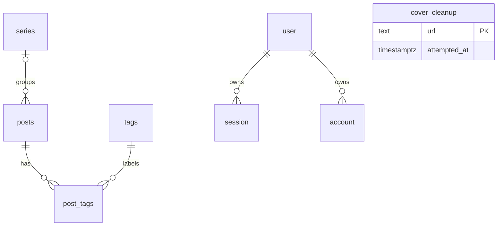

# Database structure and media lifecycle

The application keeps PostgreSQL schema definitions in `lib/db/schema.ts` and
Drizzle migrations in `drizzle/`. Better Auth's generated schema is exported from
`lib/db/auth-schema.ts`; regenerate it through its documented workflow rather
than editing framework-owned tables by hand.

## Content relationships

- Posts, series and tags use UUID primary keys and unique slugs. Posts store the
  editor's document once in JSONB. List queries project summary fields instead of
  retrieving that document.
- `post_tags` is an explicit many-to-many join with a composite primary key on
  `(post_id, tag_id)`. Both references cascade on deletion. Its primary key serves
  lookups by post; a separate tag index supports reverse lookups.
- A post optionally belongs to a series. Deleting the series sets `series_id` to
  null, preserving the article. The series/order index supports reading order,
  and a partial unique index prevents two assigned parts taking the same position.
- Post status is a PostgreSQL enum. Publication-order and generated full-text GIN
  indexes serve existing public reads. Timezone-aware timestamps record content
  creation, updates and publication.
- Better Auth's sessions and accounts reference users with cascading deletion and
  indexed user IDs. Application author access remains enforced in server code;
  the single-author site does not introduce a redundant per-post owner relation.

Drizzle relations describe how the application queries data; database foreign keys,
primary keys and unique constraints enforce the actual integrity. This distinction
follows [Drizzle's relation model](https://orm.drizzle.team/docs/relations) and
[PostgreSQL's constraint semantics](https://www.postgresql.org/docs/current/ddl-constraints.html).

## Cover cleanup

Database rows and R2 objects cannot commit in one transaction. A small cleanup
outbox records a detached cover URL in the same PostgreSQL transaction as removing,
replacing or deleting its post. Cleanup happens after that transaction succeeds.
The URL primary key deduplicates pending work; a last-attempt index supports
bounded ordered retries. See [R2 uploads](r2-uploads.md) for deletion eligibility,
shared-reference handling and failure/retry behavior.

The outbox intentionally has **no foreign key to posts**: its job must survive the
post's deletion. It represents pending object deletion, not current asset ownership.
A media registry would be a separate design if this site gains concurrent editors,
asset browsing or reusable media ownership; it is not simulated by attaching a
cascading cleanup relation to the deleted post.

## Migrations and verification

Use versioned Drizzle migrations through the existing direct database connection.
Apply the cleanup migration before running code that queues deletions. Test
against local fixtures or an isolated database branch first; deployment of code
does not apply PostgreSQL migrations. Existing content/relations are retained.

The local SQL integration and upload browser suites verify save/delete behavior
with real database transactions and simulated R2. Unit tests cover generated keys,
shared references and failure paths. Production database changes remain a separate
release step; see [Neon environments](neon-environments.md).
